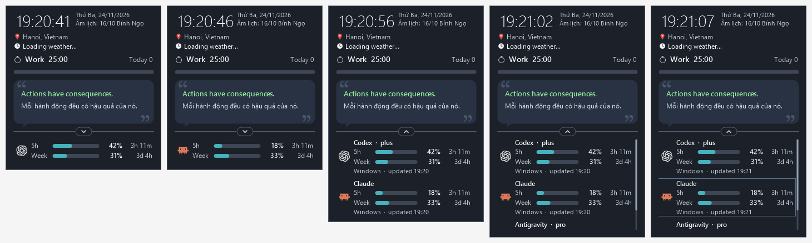
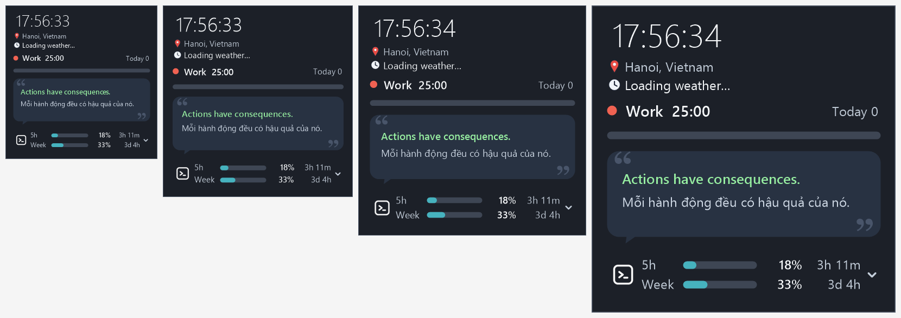
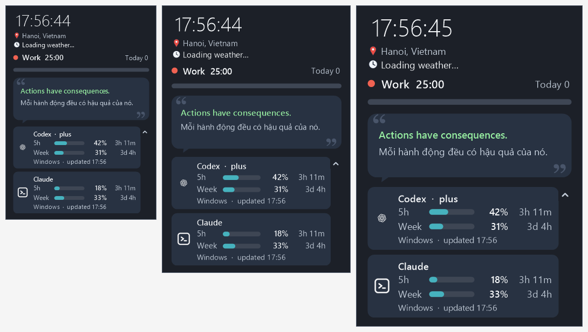
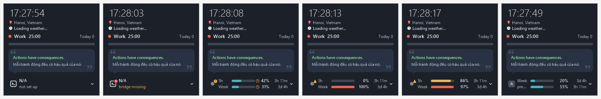
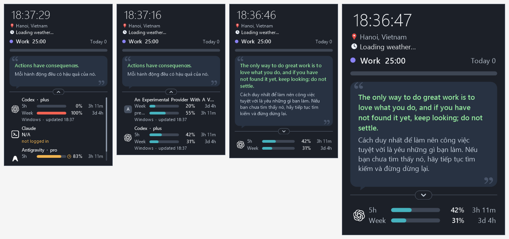
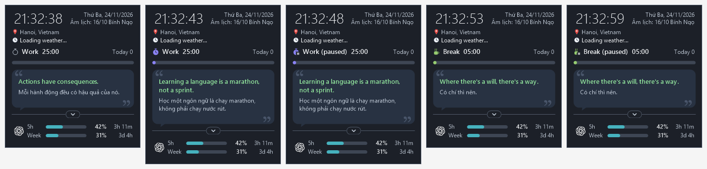
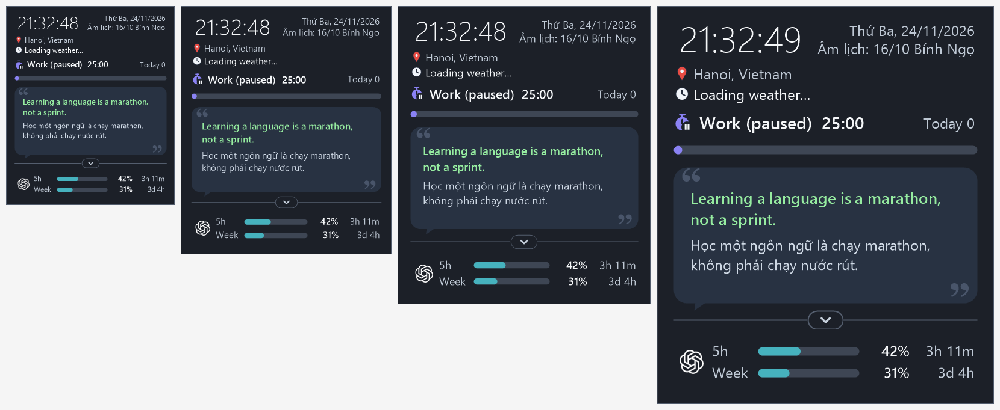
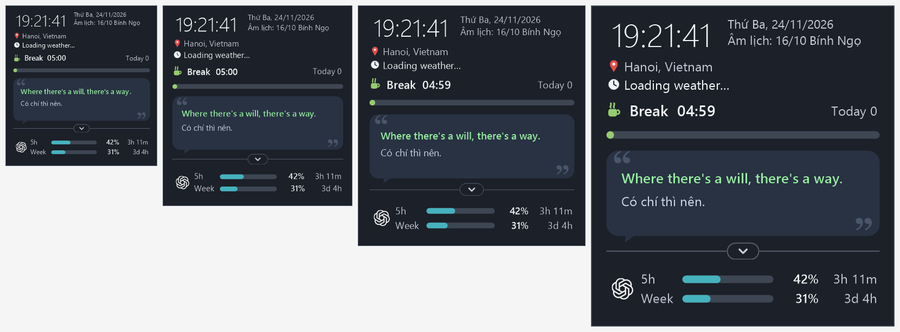

# PomoQuote


[](LICENSE)
[](https://dotnet.microsoft.com/download/dotnet/9.0)
[](#build-run-and-test)


*The clip is made mostly from real captures of the app on sample data (no account, path or personal information is shown). The taskbar strip with the robot is stylised (the robot is the real sprite sheet on a drawn bar, not a screenshot of a desktop), and the weather effects are brightened so they show in a small GIF. Ctrl+H hides the widget while it has the keyboard focus.*

**PomoQuote** is a Windows desktop app for focused work and learning English. It opens as a small always-on-top **widget** that keeps an English sentence with its Vietnamese translation in front of you, next to the time and date (with the Vietnamese lunar date), the weather (with faint weather effects behind it), a Pomodoro timer and, if you turn it on, how much of your Codex and Claude Code quota is used. The widget hides to the tray when you do not need it, there is a normal window with an analog clock too, and a small pixel-art robot walks along your taskbar while you work.

## Features

- **English sentences with Vietnamese translations.** 357 bundled offline sentences (motivation, idioms and proverbs, conversation) in large type that shrinks to fit. A new one appears at start, at each Pomodoro phase, optionally every 5/10/30/60 minutes, or on demand with **View > Next sentence (Ctrl+N)**. It shuffles through all of them before repeating and never shows the same one twice in a row. **Settings > Quotes...** picks the categories, translation on/off and the interval. Data: [Assets/Quotes/quotes.json](Assets/Quotes/quotes.json).
- **Pomodoro timer.** Work 25 min, break 5 min, long break 15 min after 4 work sessions (all adjustable in **Settings > Pomodoro...**), with Start / Pause / Resume, Skip and Reset, a progress ring, an alert sound and a balloon notification at each phase end, the remaining time in the window title, and a count of today's work sessions.
- **Weather.** Current weather for a city (default Hanoi, change it in **Settings > City...**) from [Open-Meteo](https://open-meteo.com/) (free, no API key), refreshed about every 10 minutes, with an icon for every value (sun and moon variants by day and night). Offline it keeps the last values and says so.
- **Wallpapers.** In the normal window, **View > Wallpaper** switches between three bundled photos and the plain background.
- **Taskbar mascot.** Minimize the window and it hides to the system tray while a pixel-art robot walks along the top of the taskbar, across all monitors. It reacts to the Pomodoro (brisk walk while working, shout and jump when a session ends, sleeps during breaks), can be clicked and dragged, and never takes focus. **Settings > Mascot...** sets sound, volume, speed, size, random actions and monitors.
- **Widget mode, the default.** The app now opens as the widget (see [Start mode and the tray](#start-mode-and-the-tray)). **View > Widget mode** (or **Ctrl+W**) turns the window into a small always-on-top widget (280 px wide) with the time, the date, weather, Pomodoro and the current sentence, plus your Codex and Claude Code quota if you turn on **Settings > AI Usage...**. Drag it anywhere, right-click for options, set its opacity to 100%, 80% or 60%.
- **Weather effects on the widget.** A faint animation behind the widget's text follows the weather it already shows (no extra network use): sun glints or twinkling stars for clear sky, slowly drifting clouds (denser when cloudier), haze for fog, falling streaks for drizzle and rain (more for heavier rain; icy-tinted for freezing rain), slow flakes for snow, and heavy rain with a rare, soft, brief flash for a thunderstorm. Nothing is drawn for an unknown or missing weather. See [Weather effects](#weather-effects) below.
- **Analog clock** in the normal window that shows the real time, and a single running instance of the app (starting a second copy shows the first one, also when it is hidden in the tray).

Settings live in `%AppData%\PomoQuote` (JSON files; a missing or damaged file falls back to the defaults). The app was called HelloWorldBot before: on the first start its settings in `%AppData%\HelloWorldBot` are copied over once, without overwriting or deleting anything.

## AI usage on the widget (Codex and Claude Code)

**Settings > AI Usage...** shows how much of your **Codex** and **Claude Code** quota is used, right on the widget: for the five-hour and the weekly window the percent used, a bar, the time left until the reset, your plan, and when the numbers were read (marked *stale* when they are older than twice the refresh interval). It is **off until you turn it on** there.

- **How it reads:** every 3 minutes (1 to 15, your choice) PomoQuote starts a short-lived `codex app-server` of the Codex CLI installed on this PC, asks it for the rate limits and lets it exit (10 s limit, the process is killed on timeout and when the app closes). Codex keeps your login: **PomoQuote never asks for, reads or stores a password, key or token**, never opens the Codex credential files, and never logs you in or out. If Codex says you are not logged in, run `codex login` in a terminal.
- **Settings:** enable Codex, see whether Codex is found and logged in (read-only `codex --version` and `codex login status`), **Test connection**, display order, the layout (Compact or Expanded), how often to read, and warning levels (default 80% and 95%). Warnings are a balloon notification, once per window and level (not repeated after a restart; they come back for the next window or after usage drops below the level, and never for a window whose reset time is unknown).
- **What it shows when something is wrong:** *not installed*, *not logged in*, *unsupported version* (an answer in a shape this version does not understand), or *read failed*, with the last good numbers kept and marked. One provider failing never affects another or the rest of the app. After the PC wakes from sleep or the network comes back, it reads again at once.
- **Files:** `%AppData%\PomoQuote\usage.json` (your choices), `usage-cache.json` (the last good numbers: percent, reset time, plan, hashed account key, no ids or tokens) and `usage-alerts.json` (which warnings were shown).
- **Not yet:** Windows only, **WSL is not supported yet**; Antigravity comes in a later release (the code is already built for several providers).

### Claude Code (status line bridge)

Claude Code only shows its 5-hour and weekly limits to a **status line command**, so PomoQuote can read them through a small bridge. **It never changes your Claude settings on its own**: in **Settings > AI Usage... > Claude** you click **Set up status line bridge**, a dialog shows the exact change (file, the command now, the command after, where the backup goes) and nothing is written until you click **Set up bridge** (Enter and Esc both mean Cancel).

- **What it changes:** only `statusLine` in your Claude settings file (`~/.claude/settings.json`, or `settings.json` inside `CLAUDE_CONFIG_DIR` when you have set it, as Claude Code does). With no status line yet, one is added; with your own status line command, only its `command` text is replaced. If your Claude profile has no settings file yet, a new one is created with only the status line (a note in the backup folder says there was no file before, and **Remove bridge** deletes it again if it still holds nothing else). Everything else in an existing file (other keys, order, formatting, line endings) is left as it was.
- **A stable copy of the bridge:** the status line does not run the app from the folder you started it in. When you set the bridge up, PomoQuote copies its program files to `%LocalAppData%\PomoQuote\bridge\` and the command runs that copy, so moving, deleting or updating the app's own folder cannot break your status line. The copy is refreshed after an update of PomoQuote. The bridge is only set up from `PomoQuote.exe` (not from `dotnet PomoQuote.dll`).
- **If the bridge is gone:** the installed command first checks that its program exists and otherwise runs your original status line command directly with the same input, so your own status line keeps working (if you had none, it shows nothing). That is a protection for your status line, not a promise that nothing can go wrong: while the program is gone PomoQuote cannot read Claude usage. When the window is shown, PomoQuote checks the bridge once; if the program or the saved command is missing, the bridge is the old style, or Git Bash was installed (or removed) so the command is written for a different shell than Claude Code now uses, you get a notification and the Claude strip says *bridge missing*.
- **Bridges set up by an earlier development build (old style):** a development build before 1.2.0 wrote a command that runs the program by an absolute path with no test and no fallback. If that program is moved or deleted, Claude Code runs a missing program and your status line disappears (the fallback above does not apply to it). PomoQuote recognises this form: **Check** and the start-up notification say so, and **Settings > AI Usage > Claude > Upgrade bridge...** rewrites only that one command to the new form after the same confirmation dialog (it shows the command now, the command after, the program copy and the backup folder; Cancel is the default; nothing is automatic). Your original command stays inside, byte for byte, and **Remove bridge** still restores it exactly.
- **Backup and undo:** before any change the whole file is copied to `%LocalAppData%\PomoQuote\bridge-backups\` (never overwritten; if the file changed while PomoQuote was preparing, nothing is written). **Remove bridge** first saves a fresh copy of the file as it is now, then puts your original command back (or removes the key we added), keeps edits you made later, does nothing if the line is not ours, and works even if the bridge program is gone. **Check** lists what is wrong (missing program, wrong shell, damaged saved command), and **Check a project folder** looks for a project-level `statusLine` that overrides the user-level one.
- **What it saves:** per Claude Code session one small file in `%LocalAppData%\PomoQuote\usage\` with only the percent used and reset time of each window, the Claude Code version and a hashed session key. No email, session id, folder, transcript, tokens or costs. Files older than 7 days are deleted; the newest one wins. The bridge adds well under 100 ms (about 60-120 ms measured, mostly .NET startup) and runs only when Claude Code redraws its status line.
- **What the widget shows:** *waiting for the first Claude Code answer* (the numbers appear only after the first reply of a session), *stale*, *not set up*, *no plan limits* (API-key logins have none) or *unsupported*, in the same usage area as Codex, with the same warning levels.
- **Refresh Claude now** (Settings and the widget menu): one small `claude -p` request (smallest model, one word, `--setting-sources project`, 30 s limit, killed on timeout and when the app exits) reads your current limits, e.g. right after a restart before the first session. It uses a very small amount of quota, so it asks once, runs only on a click, one at a time and at most once a minute. Nothing of the prompt or the answer is kept, and PomoQuote still never reads or stores a token or password.
- **Not yet:** Windows only (WSL is not supported), and a project-level `statusLine` is only detected for folders you check.
- **For tests and relocated configs:** `POMOQUOTE_CLAUDE_SETTINGS` names the settings file to work on (it wins over `CLAUDE_CONFIG_DIR`), and `POMOQUOTE_STATE_DIR` moves PomoQuote's own files (backups, the bridge copy). Both exist so tests and manual runs can use a throwaway file and never touch your real Claude settings.

### The widget: Compact and Expanded

The widget (280 logical px wide, scaled for 100 to 200% display scaling) keeps its dark, compact style. What changed in this release is how it is drawn, not what it reads:

- **Compact** (default) shows **one provider at a time** in at most three lines: the provider **logo on the far left**, centred on two quota rows (short window, then weekly: label, pill progress bar, percent used, countdown to the reset, all in aligned columns). There is no header or footer: the provider name, plan, source (Windows or WSL) and the time of the update are in the **logo's tooltip**. **Scroll the mouse wheel over the logo** to step through the providers like a carousel (the logo stays where it is; nothing changes by itself and nothing scrolls outside the logo), **click the logo** (or press Enter) for a list, or use the arrow keys when it has focus. A small badge on the logo says when the chosen provider has an error (red !), stale data (amber clock) or a window near its limit (amber triangle), and a small ring says another provider needs attention. The area keeps the same size whichever provider is shown.
- **Expanded** shows **every enabled provider** as its own block (plain rows, **no card, border or background**, only space between the blocks), logo on the far left, with the full name, plan, every window, percent, countdown, the source and the time of the update. The order is the one in **Settings > AI Usage > Display order**. When the blocks are taller than the limit only this area scrolls (wheel over it, or Up/Down when it has the keyboard focus); the clock and the timer stay put.
- A thin **separator line** under the quote bubble starts the usage area, and the small **arrow button sits centred on that line** (the same place in Compact and Expanded, no extra row). It switches between the two layouts; the layout and the chosen provider are remembered after a restart. Expanding grows the window **downward** from its top edge, so the clock and the timer stay where they are; when the screen is short only the usage area scrolls sooner.
- **Progress bars** are pills (rounded track and fill) for the timer and the quotas, honest at 0% (nothing drawn, no stray dot), tiny values and 100%. The timer uses a violet (work), a green (short break) or a blue (long break), quotas a teal, and amber or red only for quota warnings. Hover a row for the exact used and left percent and the reset time.
- **N/A, stale, errors:** a missing quota shows **N/A**, never 0%. Stale numbers carry a clock icon, the badge and a tooltip, not only a colour. When a refresh runs (longer than 0.4 s), the last numbers stay on screen and only that provider gets a small circular-arrow "updating" mark (on its logo in Compact, in its block header in Expanded, and in its tooltip). When the latest read has no plan limits or no reply but an earlier good reading is still shown, the numbers stay and get the same clock icon, badge and amber note ("no plan limits; data from 10:20"), so they are never silently old. Windows are named by what the data says (5h, Week, or its real length such as 3h), never forced into 5 hours and a week; long names end with an ellipsis and the tooltip has the full text.
- **The sentence** is a message-bubble card (blue-grey, rounded, with a small tail and light decorative quotation marks) with the sentence in front (13 px) and the translation a size smaller (12 px). The text wraps and the card grows instead of cutting it off, up to a clamp of about 210 px; the text keeps **12 px or more** until that clamp is reached, only then does it go smaller (down to 10.5 px), and only past that is the last line ended with an ellipsis. The closing quotation mark has its own room under the last line and never covers text.
- **Keyboard and accessibility:** the logo selector (Compact) and the arrow button are focusable controls with accessible names. **Expanded is a keyboard list**: Tab gives it the focus, Up/Down/Home/End move between the provider blocks and scroll the focused one into view, the focused block gets a dotted focus rectangle, and every block is an accessible list item whose name is the provider and plan and whose description has its windows, percents, resets, source and update time. The quotation marks are drawn decoration, not text, so a screen reader does not read them out. Hover the **timer bar** for the phase, the elapsed and remaining time and the exact end time.
- **One width:** the widget is a fixed 280 px wide at 100% (scaled with the display); **no narrower layout is supported**. A test measures the longest labels, percents and countdowns against their columns at that width.

*The previews below are made with test data. This version shows Codex and Claude Code only: where a preview has a third provider (Antigravity, or a test provider with a long name), it is a sample of the layout for a later release, not something the app shows today.*











### The clock, the date and the Pomodoro icon

- **Date on the time row, on two lines, right-aligned:** the two lines are centred on the height of the clock digits and end flush at the widget's right content margin (the same right edge as the quota columns), in the room between the clock and that margin; the solar date in Vietnamese (`Thứ Ba, 24/11/2026`) and the Vietnamese lunar date (`Âm lịch: 16/10 Bính Ngọ`, a leap month is marked `nhuận`, the year is named by its heavenly stem and earthly branch). The solar date is your PC's local date. The lunar date is computed in the program (no network, no data table) with the astronomical algorithm of **Hồ Ngọc Đức** (new moons and the sun's longitude after Jean Meeus) at **UTC+7**, which is what makes it the Vietnamese calendar rather than the Chinese one. It is worked out once a day: when the local date changes (midnight, or a wake-up from sleep on another day) and not at every clock tick. The text is 12 px (never below 11.5 px where the room allows) and shrinks step by step down to 10 px only when a long line needs it (a leap month); it never overlaps the clock.
- **Pomodoro state icon** next to the timer, in the same column, size (14 px) and gap as the weather icons: a stopwatch outline for **Idle** (not started), a filled stopwatch for **Work**, a cup for **Rest** (short and long break; the phase colour tells them apart), and a small pause mark over the phase icon while the timer is **paused**. The accessible name says it ("Pomodoro work, paused"), and the timer bar tooltip is unchanged.






### Provider logos

Codex shows the official OpenAI Blossom, Antigravity (when it is added) the official Antigravity icon, both unmodified files whose empty margins are cut at load time and then scaled so the visible mark fills an about 20 px box at full brightness; Claude shows Anthropic's official **Claude Spark** from its public press kit, unmodified (only cropped of its empty margin and scaled): the owner accepted the trademark risk and **PomoQuote has no written permission from Anthropic**, so delete `Assets/Providers/claude-on-dark.png` and `claude-on-light.png` to go back to the neutral glyph (no code change; the neutral glyph `claude-neutral-on-*` is also the fallback if the file is missing or damaged). The marks belong to their owners and PomoQuote is not affiliated with or endorsed by any of them. Sources, hashes, terms and the decision are in [THIRD_PARTY_ASSETS.md](THIRD_PARTY_ASSETS.md).
## Start mode and the tray

- **Start in** (**Settings > Start in**, also in the widget's right-click menu and the tray menu): **Widget** (the default, also when nothing was ever saved), **Normal window**, or **Remember last** (the mode you closed the app in). Saved atomically in `%AppData%\PomoQuote\widget.json`; a missing or damaged file means Widget.
- **Hide to tray from the widget.** Right-click the widget > **Hide to tray**, or press **Ctrl+H** while the widget has the keyboard focus. In widget mode the tray icon is always there: a left click hides or shows the widget, a double click shows it, and the right-click menu has **Show widget / Hide widget**, **Normal window**, **Start Pomodoro**, **Settings** (with **Start in**) and **Exit**. Starting a second copy of the app while the widget is hidden shows the first one (it never opens a second instance).
- **While hidden** there is no taskbar button and nothing is drawn: the weather effect timer and the clock tick stop (zero ticks). The weather, AI usage and Pomodoro timers keep running, and a Pomodoro phase end still plays its sound and shows the balloon. Showing it again puts the widget back where it was, with its opacity, layout and selected provider (moved into a visible work area if its monitor is gone).
- The widget never has a taskbar button (it lives in the tray). Leaving widget mode (Ctrl+W) always gives the normal window its title-bar logo and its taskbar button, also when the app started as the widget.

## Weather effects

The effect is drawn behind the widget's text, icons, bars, quote bubble and AI usage area (they keep their own backgrounds) and never changes the widget's size or layout. Every Open-Meteo weather code the app understands maps to an effect in one table, `Weather/WeatherEffectMapping.cs` (code to kind and level, with day and night colours; clear sky is glints by day and stars by night).

**Settings > Weather effects...** (also in the widget's right-click menu and the tray menu):

- **On or off.** On by default: the effect is faint and it stops by itself whenever nobody can see it.
- **Intensity.** **Low** (the default) draws about half the particles of **Normal**; **Normal** draws the full effect. Both update about 15 times a second.
- **Reduce motion.** Shows one still picture instead of an animation. The effect is also a still picture whenever Windows has animations turned off (Settings > Accessibility > Visual effects > Animation effects).

The effect has its own timer, which exists only while the effect is on, the widget is visible and nothing hides it: it makes no tick while the widget is minimised, hidden or in the tray, covered by other windows, the Windows session is locked or the computer sleeps. At most a few dozen particles are drawn from a fixed pool with cached drawing objects (nothing is allocated per frame), every colour is faint, by design, so the effect is subtle: a test composites the exact colours and opacities the renderer uses, with up to 4 streaks, flakes or cloud puffs lying on top of each other (and a thunderstorm's flash on top of them), over the widget's panel and requires a contrast of 4.5:1 for the secondary text and 7:1 for the primary text (a second test samples the real renderer for every code at 100% and 200%); glints and stars never overlap. A thunderstorm flashes once every 15 to 40 seconds, softly (a rise of half a second), and a change of weather, or of day to night, cross-fades over about a second. The choices are saved in `%AppData%\PomoQuote\weather-effects.json` (a missing or damaged file falls back to the defaults).

## Build, run and test

Requires Windows and the [.NET 9 SDK](https://dotnet.microsoft.com/download/dotnet/9.0).

```powershell
git clone https://github.com/quanap5/PomoQuote.git
cd PomoQuote
dotnet build
dotnet run
dotnet test PomoQuote.Tests
```

There is no CI for this repository yet, so run the tests locally before a pull request.

## Changes and versions

Notable changes are listed in [CHANGELOG.md](CHANGELOG.md) ([SemVer](https://semver.org/)). The version is set once, as `<Version>` in `PomoQuote.csproj`, and shown in **Help > About**.

## Credits and licenses

PomoQuote is released under the [MIT License](LICENSE). The bundled assets have their own, compatible terms, listed in the `CREDITS.md` file of each folder:

| Assets | License | Credits |
|--------|---------|---------|
| Sentences and Vietnamese translations | Public-domain quotations and proverbs, original sentences and translations under CC0 1.0 | [Assets/Quotes/CREDITS.md](Assets/Quotes/CREDITS.md) |
| Mascot sprites (original), shout sound | CC0 1.0 | [Assets/Mascot/CREDITS.md](Assets/Mascot/CREDITS.md) |
| Pomodoro alert sounds | CC0 1.0 | [Assets/Sounds/CREDITS.md](Assets/Sounds/CREDITS.md) |
| Wallpaper photos | CC0 1.0 | [Assets/Wallpapers/CREDITS.md](Assets/Wallpapers/CREDITS.md) |
| Weather icons (original vector drawings) | CC0 1.0 | [Assets/Weather/CREDITS.md](Assets/Weather/CREDITS.md) |
| PomoQuote logo and icon (original work) | MIT, like the code | [Assets/Logo/CREDITS.md](Assets/Logo/CREDITS.md) |

Weather and city search data come from [Open-Meteo](https://open-meteo.com/) under [CC BY 4.0](https://creativecommons.org/licenses/by/4.0/) ([terms](https://open-meteo.com/en/terms)); the free API is for non-commercial use and requires attribution. The intro GIF is made from screenshots of the app itself.

## How the team works on it

This repository is also the practice project the OrcaTeam uses to try its flow: the Developer makes each change on its own branch and opens a draft pull request, the Reviewer and QA check the exact commit, and the owner merges.

## License

[MIT](LICENSE) © 2026 quanap5
