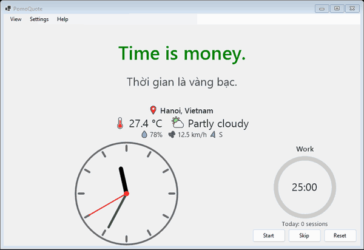

# PomoQuote


[](LICENSE)
[](https://dotnet.microsoft.com/download/dotnet/9.0)
[](#build-run-and-test)



**PomoQuote** is a Windows desktop app for focused work and learning English. It keeps an English sentence with its Vietnamese translation in front of you, next to a Pomodoro timer, the weather and an analog clock, and a small pixel-art robot walks along your taskbar while you work.

## Features

- **English sentences with Vietnamese translations.** 357 bundled offline sentences (motivation, idioms and proverbs, conversation) in large type that shrinks to fit. A new one appears at start, at each Pomodoro phase, optionally every 5/10/30/60 minutes, or on demand with **View > Next sentence (Ctrl+N)**. It shuffles through all of them before repeating and never shows the same one twice in a row. **Settings > Quotes...** picks the categories, translation on/off and the interval. Data: [Assets/Quotes/quotes.json](Assets/Quotes/quotes.json).
- **Pomodoro timer.** Work 25 min, break 5 min, long break 15 min after 4 work sessions (all adjustable in **Settings > Pomodoro...**), with Start / Pause / Resume, Skip and Reset, a progress ring, an alert sound and a balloon notification at each phase end, the remaining time in the window title, and a count of today's work sessions.
- **Weather.** Current weather for a city (default Hanoi, change it in **Settings > City...**) from [Open-Meteo](https://open-meteo.com/) (free, no API key), refreshed about every 10 minutes, with an icon for every value (sun and moon variants by day and night). Offline it keeps the last values and says so.
- **Wallpapers.** **View > Wallpaper** switches between three bundled photos and the plain background.
- **Taskbar mascot.** Minimize the window and it hides to the system tray while a pixel-art robot walks along the top of the taskbar, across all monitors. It reacts to the Pomodoro (brisk walk while working, shout and jump when a session ends, sleeps during breaks), can be clicked and dragged, and never takes focus. **Settings > Mascot...** sets sound, volume, speed, size, random actions and monitors.
- **Widget mode.** **View > Widget mode** (or **Ctrl+W**) turns the window into a small always-on-top widget (about 260x210) with the time, weather, Pomodoro and the current sentence. Drag it anywhere, right-click for options, set its opacity to 100%, 80% or 60%.
- **Analog clock** that shows the real time, and a single running instance of the app.

Settings live in `%AppData%\PomoQuote` (JSON files; a missing or damaged file falls back to the defaults). The app was called HelloWorldBot before: on the first start its settings in `%AppData%\HelloWorldBot` are copied over once, without overwriting or deleting anything.

## Build, run and test

Requires Windows and the [.NET 9 SDK](https://dotnet.microsoft.com/download/dotnet/9.0).

```powershell
git clone https://github.com/quanap5/PomoQuote.git
cd PomoQuote
dotnet build
dotnet run
dotnet test PomoQuote.Tests
```

There is no CI for this repository yet, so run the tests locally before a pull request.

## Changes and versions

Notable changes are listed in [CHANGELOG.md](CHANGELOG.md) ([SemVer](https://semver.org/)). The version is set once, as `<Version>` in `PomoQuote.csproj`, and shown in **Help > About**.

## Credits and licenses

PomoQuote is released under the [MIT License](LICENSE). The bundled assets have their own, compatible terms, listed in the `CREDITS.md` file of each folder:

| Assets | License | Credits |
|--------|---------|---------|
| Sentences and Vietnamese translations | Public-domain quotations and proverbs, original sentences and translations under CC0 1.0 | [Assets/Quotes/CREDITS.md](Assets/Quotes/CREDITS.md) |
| Mascot sprites (original), shout sound | CC0 1.0 | [Assets/Mascot/CREDITS.md](Assets/Mascot/CREDITS.md) |
| Pomodoro alert sounds | CC0 1.0 | [Assets/Sounds/CREDITS.md](Assets/Sounds/CREDITS.md) |
| Wallpaper photos | CC0 1.0 | [Assets/Wallpapers/CREDITS.md](Assets/Wallpapers/CREDITS.md) |
| Weather icons (original vector drawings) | CC0 1.0 | [Assets/Weather/CREDITS.md](Assets/Weather/CREDITS.md) |
| PomoQuote logo and icon (original work) | MIT, like the code | [Assets/Logo/CREDITS.md](Assets/Logo/CREDITS.md) |

Weather and city search data come from [Open-Meteo](https://open-meteo.com/) under [CC BY 4.0](https://creativecommons.org/licenses/by/4.0/) ([terms](https://open-meteo.com/en/terms)); the free API is for non-commercial use and requires attribution. The intro GIF is made from screenshots of the app itself.

## How the team works on it

This repository is also the practice project the OrcaTeam uses to try its flow: the Developer makes each change on its own branch and opens a draft pull request, the Reviewer and QA check the exact commit, and the owner merges.

## License

[MIT](LICENSE) © 2026 quanap5
